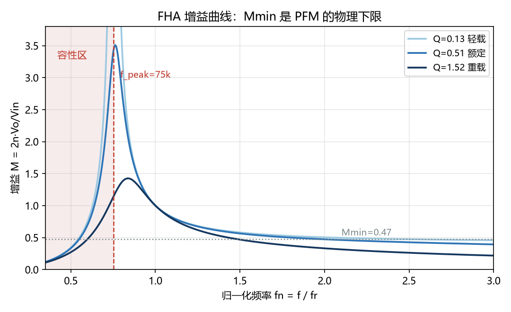
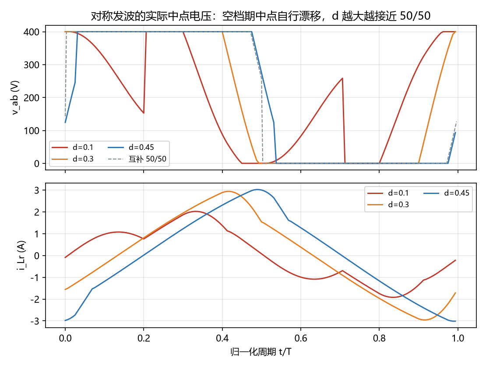
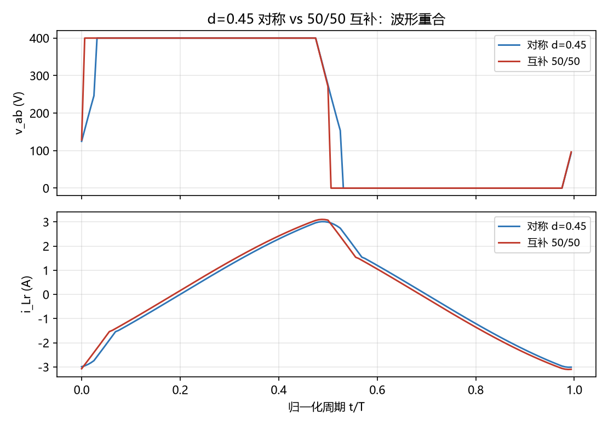
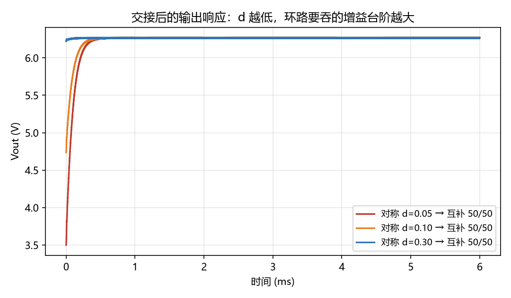
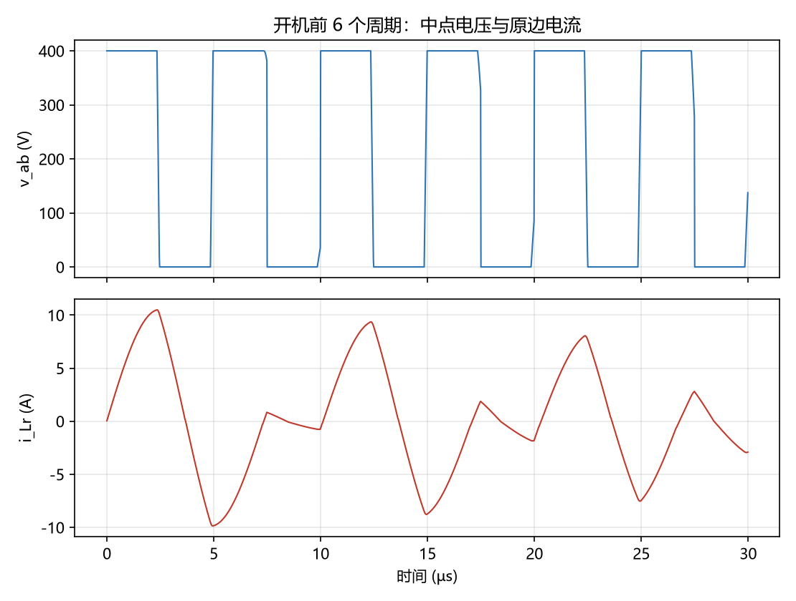
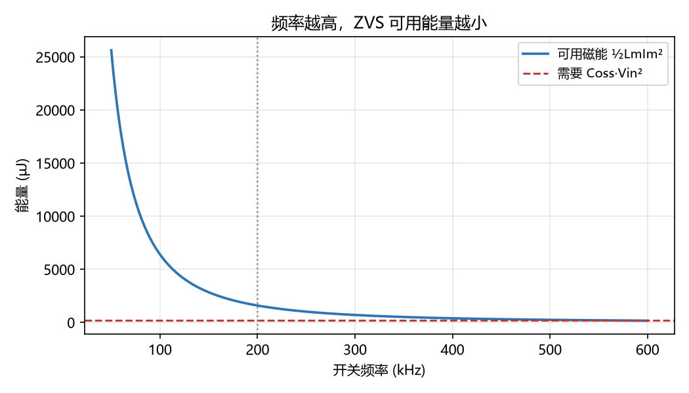
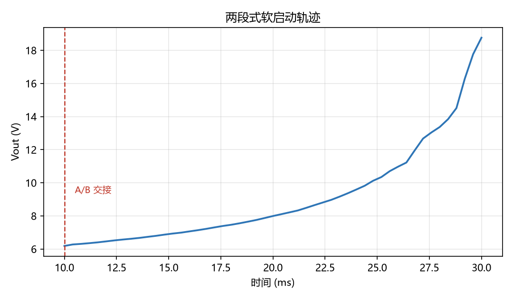
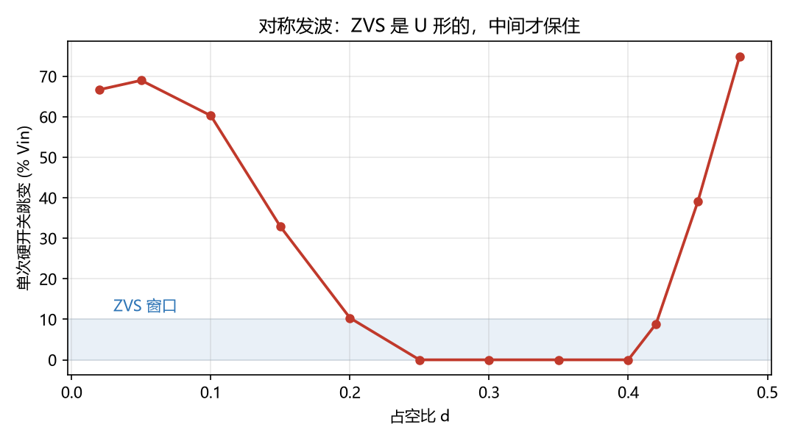

# 半桥 LLC 软启动验证报告（模型自动生成）

参数基线：Vin=400 V, n=16, fr=100 kHz, Lr=60 µH, Cr=42 nF, Lm=78 µH, Cout=1000 µF, fmax=200 kHz, fmin=60 kHz, dead=150 ns

> 这是**示例参数**，请替换成你自己的实测值后重跑。比值和趋势是稳健的，绝对电压值取决于你的匝比与谐振腔。

## 用例 0｜模型自检：时域仿真 vs FHA 解析

先证明工具可信，再拿它下结论。互补 50/50、稳态、比较 Vout：

| f (kHz) | FHA 预测 | 时域仿真 | 偏差 |
|---|---|---|---|
| 100 | 12.50 V | 12.58 V | +0.7% |
| 130 | 8.04 V | 8.73 V | +8.5% |
| 160 | 6.72 V | 7.28 V | +8.3% |
| 200 | 5.91 V | 6.27 V | +6.1% |
| 250 | 5.33 V | 5.51 V | +3.3% |

**判读**：fn=1 处只差 0.6%，fn=1.3~2.5 差 3~9%（FHA 忽略了死区、二极管压降和谐波）。**FHA 用来判量程够用，用来定精确工作点不够**；越靠近峰值误差越大。

第二件事：**步长敏感性**。d=0.05 时脉宽只有 250 ns，如果每周期只采样 160 点，脉宽被量化到 1/160 = 0.63%，相当于占空比本身有 12% 的误差。

| 每周期点数 dt | 等效脉宽分辨率 | d=0.05 稳态 Vout |
|---|---|---|
| T/120 | 0.83% | 3.37 V |
| T/320 | 0.31% | 3.50 V |
| T/640 | 0.16% | 3.56 V |

**所以：小占空比工况下，步长必须细到 T/300 以上，否则你测到的「低占空比增益」是数值噪声，不是电路行为。**

## 用例 1｜增益曲线与量程上限（FHA 解析）

- Z0 = 37.80 Ω，Ln = 1.30，Rac = 74.7 Ω，Q = 0.506
- 峰值点 fn = 0.752 → f_peak = 75.2 kHz
- fmin = 60 kHz **已越过峰值，属容性区**

> 注意：FHA 的 M 定义为 **M = 2n·Vo/Vin**，所以 **Vo = M·Vin/(2n)**。少写这个 2 会让输出电压差一倍——这是最容易犯的错。

| f (kHz) | fn | M | Vout = M·Vin/(2n) |
|---|---|---|---|
| 60 | 0.60 | 0.705 | 8.8 |
| 75 | 0.75 | 3.386 | 42.3 |
| 85 | 0.85 | 1.897 | 23.7 |
| 100 | 1.00 | 1.000 | 12.5 |
| 130 | 1.30 | 0.643 | 8.0 |
| 200 | 2.00 | 0.473 | 5.9 |
| 250 | 2.50 | 0.426 | 5.3 |

**Mmin(fmax) = 0.473 → Vout_min = 5.9 V**

> 这组示例参数算出来是 5.9 V，不是 12 V。**Mmin 由 Ln 和 fmax/fr 决定，不是设计者指定的**。要让 200 kHz 对应 12 V，需要 Vin/(2n) = 25.4 V，即 n ≈ 7.9。把你的 Lr/Cr/Lm/n 填进 P，这个数才是你的真值。

## 用例 2｜对称带空档发波的真实波形

文档里的说法：基波 ∝ sin²(πd)，d=0.3→0.5 只差 1.53 倍。

| d | 实测 |V(f)| | 实测 |V(2f)| | v_ab 均值 | Vout | 相对 50/50 的倍数 |
|---|---|---|---|---|---|
| 0.05 | 126.2 V | 8.5 V | 196 V | 3.50 V | 0.496× |
| 0.10 | 175.9 V | 1.8 V | 200 V | 4.74 V | 0.692× |
| 0.20 | 247.1 V | 0.4 V | 200 V | 6.13 V | 0.972× |
| 0.30 | 251.4 V | 0.0 V | 200 V | 6.23 V | 0.989× |
| 0.40 | 251.4 V | 0.0 V | 200 V | 6.23 V | 0.989× |
| 0.45 | 253.2 V | 0.1 V | 200 V | 6.25 V | 0.996× |

基准（互补 50/50，f=200k）：|V(f)| = 254.3 V，Vout = 6.27 V

**这张表推翻了「对称发波基波 ∝ sin²(πd)」这个说法，而且推翻得比预想更彻底。**

原因：空档期两个管子都关断，中点电压由谐振电流给 Coss 充放电决定。电流小时中点会**从 0 一路漂到 Vin**（或反过来），所以 v_ab 根本不是「窄脉冲串」，而是**梯形**。梯形在低频段的基波远大于同宽度的窄脉冲。

所以真正的有效调节区间只有 **d = 0 ~ 0.2**：d=0.2 就到 50/50 的 97%，d≥0.3 完全饱和，再加占空比什么都不会变。

### Coss 敏感性（这是本模型最不确定的地方）

| Coss (nF) | d=0.05 | d=0.10 | d=0.20 | d=0.30 | d=0.45 | 50/50 |
|---|---|---|---|---|---|---|
| 0.3 | 1.72 | 2.41 | 3.91 | 6.27 | 6.27 | 6.27 |
| 1.5 | 3.50 | 4.74 | 6.13 | 6.23 | 6.25 | 6.27 |
| 4.0 | 4.01 | 4.39 | 5.10 | 5.88 | 6.26 | 6.27 |

**低端增益对 Coss 敏感（d=0.05 在 1.7~4.0 V 之间变化），但「d≥0.3 饱和」这一条在所有 Coss 下都成立。** 所以：饱和点是稳健结论，低端的具体增益必须靠实测标定。

## 用例 3｜对称 d=0.45 与互补 0.50 是不是同一个东西

| 指标 | 对称 d=0.45 | 互补 50/50 | 差 |
|---|---|---|---|
| Vout (V) | 6.221 | 6.238 | 0.28% |
| Cr 均值 (V) | 200.005 | 200.006 | 0.00% |
| i_Lr 正峰 (A) | 3.011 | 3.104 | 2.97% |
| i_Lr 负峰 (A) | -3.011 | -3.104 | 2.97% |

**结论：两者几乎完全相同。** 所谓「从对称切到互补」不是切换两个模式，而是同一条曲线走到了终点。

## 用例 4｜互补 30%/70% 稳态：Cr 到底隔不隔直

- Cr 平均电压 = **118.5 V**（理论 0.30×Vin = 120 V），纹波 86 Vpp
- i_Lr 正峰 3.48 A / 负峰 -2.17 A，**不对称度 37.6%**
- Vout = 5.39 V（50/50 时是 6.44 V）

**判读**：Cr 自己稳到 0.3Vin，稳态伏秒自动平衡，「小占空比必然偏磁饱和」**不成立**。但正负峰差这么多，两个管子的电流应力和损耗严重不均——**这才是 d≠0.5 的真实代价，不是饱和。**

## 用例 5｜交接台阶：从对称 d 切到互补 50/50

这是真实交接路径：A 段是对称发波，B 段是互补 50/50。

| 交接点 | 交接前 Vout | 交接后稳态 | 增益台阶 | 每周期磁通净增量 |
|---|---|---|---|---|
| d=0.05 | 3.50 V | 6.27 V | +79.2% | 29 µV·s |
| d=0.10 | 4.74 V | 6.27 V | +32.4% | 46 µV·s |
| d=0.20 | 6.13 V | 6.27 V | +2.3% | 55 µV·s |
| d=0.30 | 6.23 V | 6.27 V | +0.7% | 31 µV·s |
| d=0.45 | 6.25 V | 6.27 V | +0.3% | 62 µV·s |

**判读**：增益台阶随 d 迅速收敛。**d ≥ 0.20 时台阶已经小于 2.3%**，d=0.45 交接只有 +0.3%。

所以：**如果你在 30% 交接看到明显振荡，原因大概率不是占空比台阶，而是频率环路**（fmax 余量不足、积分器初值不对、限幅太紧）。这条推论可以直接指导你下一步查哪里——先抓频率指令，看交接后有没有顶到 fmax。

## 用例 6｜开机瞬态：Cr 从 0 起充，冲击在哪

- 稳态原边电流峰值 = 3.10 A
- 第 1 / 5 / 20 / 100 周期峰值 = 10.49 / 8.05 / 4.35 / 3.09 A
- **开机最大冲击 = 10.49 A = 稳态的 3.38 倍**，出现在第 1 个周期
- 磁通：每周期净增量最大 38 µV·s，稳态残差 3.1 µV·s（占磁通峰值 214 的 1.5%，属数值残差）
- Cr 周期均值在 0.2 ms 时 = 200 V（目标 200 V）
- Cr 周期均值在 0.5 ms 时 = 200 V（目标 200 V）
- Cr 周期均值在 2.0 ms 时 = 200 V（目标 200 V）

**判读**：冲击不是「电压高」造成的，是「Cr 从 0 充到 Vin/2 这段路上，多出来的电荷全部要从原边灌进去」。倍率越大、持续越久，变压器和管子的应力越大。软启动要压的就是这一段。

## 用例 7｜ZVS 的能量判据与频率上限

判据：½·Lm·Im² ≥ Coss·Vin²，其中 Im = Vin/(4·Lm·fs)
→ **fs_max = 1 / sqrt(32·Lm·Coss)**

| Lm (µH) | Coss (nF) | fs_max (kHz) | fmax=200k |
|---|---|---|---|
| 78 | 1.5 | 517 | 余量 158% |
| 78 | 3.0 | 365 | 余量 83% |
| 200 | 1.5 | 323 | 余量 61% |
| 200 | 3.0 | 228 | 余量 14% |

**判读**：抬 fmax 扩增益范围，代价是起扫段的 ZVS 余量。这是纯扫频方案自己的边界。

## 用例 8｜1% 占空比到底能不能发出来

- f=200k, d=1% → 脉宽 50 ns，死区 150 ns，**脉宽 < 死区，上管根本不开通**
- f=200k, d=5% → 脉宽 250 ns，死区 150 ns，可用
- f=250k, d=1% → 脉宽 40 ns，死区 150 ns，**脉宽 < 死区，上管根本不开通**
- f=250k, d=5% → 脉宽 200 ns，死区 150 ns，可用

- 仿真：d=0.01、f=200k → Vout = 0.000 V（上管被死区完全吃掉）

**陷阱**：如果模型里不建死区，这个 50 ns 脉冲会正常出现、输出也正常——**仿真会骗你**。做这类验证，死区必须建模，而且必须和真实驱动器的传输延迟对齐。

## 用例 9｜两段式全程：A 段爬占空比 + B 段扫频

- A 段（f=200k 固定，d 0.05→0.45，10 ms）：Vout 0 → **6.18 V**
- B 段（d=0.5，f 200k→85k，20 ms）：Vout → **18.76 V**
- 全程过冲 = +0.0%（交接点无台阶则接近 0）

**判读**：A 段把 Vout 抬到 Mmin 附近，B 段从同一个点接着扫频，整条轨迹单调、无跳变。**关键是 A 段结束电压必须落在 Mmin 上，不能越过它。**

## 用例 10｜第二版新增校核：中点浮空导致的三条结论

### 10.1 理想三电平波形的频谱（纯数学，不含电路）

波形：两个等宽脉冲，居中于 T/4 与 3T/4。若中点真被钳住，这就是它的频谱。

| d | \|V(f)\| | \|V(2f)\| | \|V(3f)\| | 均值 |
|---|---|---|---|---|
| 0.05 | **0.0000** | 0.1969 | 0.0000 | 0.100 |
| 0.20 | **0.0000** | 0.6054 | 0.0000 | 0.400 |
| 0.30 | **0.0000** | 0.6054 | 0.0000 | 0.600 |
| 0.45 | **0.0000** | 0.1969 | 0.0000 | 0.900 |

**判读**：`f` 分量在所有 `d` 下都是 0.0000。因为 `v(t+T/2) = v(t)`，波形周期实际是 `T/2`——两个等宽对称脉冲的基波精确抵消。文档 v1 的 `(4/π)sin²(πd)` 漏了一个负号。

自我检查：`d=0.5` 时均值 1.0、交流全零（没有输出）——荒谬。说明该理想模型在 `d→0.5` 处失效，只能当参考。

### 10.2 互补发波：增益是否 ∝ sin(πd)

| d | Vout | 相对满增益 | sin(πd) | 偏差 |
|---|---|---|---|---|
| 0.05 | 1.33 V | 0.213 | 0.156 | +36% |
| 0.10 | 2.54 V | 0.406 | 0.309 | +31% |
| 0.20 | 4.36 V | 0.695 | 0.588 | +18% |
| 0.30 | 5.39 V | 0.859 | 0.809 | +6% |
| 0.45 | 6.22 V | 0.991 | 0.988 | +0% |

满增益基准（互补 50/50，f=200k）= 6.27 V。

**判读**：实测系统性略高于 `sin(πd)`（d 小时差 37%，d≥0.3 时差 6% 以内），因为增益不是基波的线性函数。**趋势和量级对得上：d=0.3 是 0.86，跳到 0.5 是 1.16 倍。**互补发波下 `d` 是一个刻度干净的旋钮。

### 10.3 对称发波：中点有多少时间在「漂」

| d | 中间态占比 | 高电平占比 | v_ab 均值/Vin | Vout | 相对满增益 |
|---|---|---|---|---|---|
| 0.05 | **88.1%** | 5.9% | 0.499 | 3.55 V | 0.567 |
| 0.10 | **53.8%** | 23.3% | 0.501 | 4.77 V | 0.761 |
| 0.20 | **20.6%** | 39.7% | 0.500 | 6.15 V | 0.981 |
| 0.30 | **16.2%** | 42.0% | 0.501 | 6.24 V | 0.995 |
| 0.45 | **9.5%** | 45.2% | 0.499 | 6.27 V | 0.999 |

**判读**：三条结论。
1. `d=0.05` 时 88% 的时间中点在中间漂着——波形是三角波，不是脉冲串；
2. `d=0.45` 时中间态只剩 9.5%，已经是方波。所以 `d` 只改变**波形形状**；
3. **`v_ab` 均值在所有 `d` 下都是 0.5·Vin**，不是 `d·Vin`。所以对称发波下 `Cr` 恒在 `Vin/2`，没有充电瞬态。

### 10.4 中点过渡时间（判断你在哪个区间）

`t_slew = 2·Coss·Vin / |i_Lr|`，与空档 `(0.5-d)T` 比较。

| 原边电流 | t_slew | 占周期比 @200k | 属于哪个区间 |
|---|---|---|---|
| 0.9 A | 1333 ns | 26.7% | 三角波（增益由电流定） |
| 3.0 A | 400 ns | 8.0% | 梯形（过渡中） |
| 10.0 A | 120 ns | 2.4% | 方波（增益=满） |

**判读**：电流越小，中点越「赖着不走」。而软启动初期电流本来就小——**所以对称发波的增益下限由 `Coss` 和电流决定，不由 `d` 决定。**这是它不能当增益旋钮的根本原因。

## 用例 11｜新理论的三条支柱

这一节不谈策略，只回答三个纯物理问题，它们是后面所有设计规则的地基：

1. `v_ab` 的**均值**由谁决定？
2. `v_ab` 的**基波**由谁决定？
3. **ZVS** 什么时候还在、什么时候丢了？

### 11.1 均值定理：`v_ab` 的直流分量

| d | 对称 mean/Vin | 互补 mean/Vin | 对称 Vout | 互补 Vout |
|---|---|---|---|---|
| 0.03 | **0.500** | **0.000** | 3.13 V | 0.00 V |
| 0.05 | **0.499** | **0.051** | 3.55 V | 1.38 V |
| 0.10 | **0.501** | **0.099** | 4.77 V | 2.58 V |
| 0.20 | **0.500** | **0.198** | 6.15 V | 4.38 V |
| 0.30 | **0.501** | **0.298** | 6.24 V | 5.40 V |
| 0.45 | **0.499** | **0.449** | 6.27 V | 6.23 V |

**判读**：对称发波的均值恒为 `0.500·Vin`，与 `d` 无关；互补发波精确等于 `d·Vin`。
这不是数值巧合，是两条独立约束的直接结果：

- 对称驱动下 `t → t+T/2` 时上下管互换，`v_ab → Vin − v_ab`，故均值必为 `Vin/2`；
- 互补驱动下，`d` 就是高电平的时间占比，均值必为 `d·Vin`。

**推论**：`Cr` 的稳态电压 = `v_ab` 的周期均值。对称发波下 `Cr` 永远在 `Vin/2`，
没有直流偏置、没有充电瞬态；互补发波下 `Cr = d·Vin`，改 `d` 就是改 `Cr` 的工作点。

### 11.2 基波定律（互补）：`|V1| = (2Vin/π)·sin(πd)`，与负载无关

| d | 重载 |V1|/Vin | 中载 |V1|/Vin | 轻载 |V1|/Vin | (2/π)sin(πd) | 偏差 |
|---|---|---|---|---|---|
| 0.05 | 0.100 | 0.099 | 0.100 | 0.100 | +0.1% |
| 0.10 | 0.195 | 0.195 | 0.197 | 0.197 | -1.0% |
| 0.20 | 0.370 | 0.372 | 0.374 | 0.374 | -1.0% |
| 0.30 | 0.512 | 0.513 | 0.515 | 0.515 | -0.6% |
| 0.45 | 0.627 | 0.628 | 0.628 | 0.629 | -0.2% |

**判读**：三种负载下同一 `d` 的 `|V1|` 差异 < 1%，且精确符合 `(2/π)sin(πd)`。
**互补发波的波形只由 `d` 决定，与电流、负载都无关——它是一个真正的旋钮。**

### 11.3 反例（对称）：`|V1|` 是电流的函数

| d | 重载 |V1|/Vin | 中载 |V1|/Vin | 轻载 |V1|/Vin | 极差 |
|---|---|---|---|---|
| 0.05 | 0.321 | 0.509 | 0.563 | **43%** |
| 0.10 | 0.443 | 0.583 | 0.602 | **26%** |
| 0.20 | 0.619 | 0.617 | 0.615 | **1%** |
| 0.45 | 0.633 | 0.633 | 0.634 | **0%** |

**判读**：`d=0.05` 时同一个占空比能给出 0.321 到 0.563 两种基波，差 75%；`d≥0.20` 才收敛。
原因是波形由谐振电流在节点电容上的积分决定，而电流本身随增益变——
**这是一个闭环，不是一个旋钮。**

### 11.4 两种发波的可调范围（满载，f=200 kHz）

| d | 对称 Vout | 对称/满 | 互补 Vout | 互补/满 |
|---|---|---|---|---|
| 0.02 | 2.97 V | 0.472 | 0.00 V | 0.000 |
| 0.05 | 3.55 V | 0.565 | 1.38 V | 0.220 |
| 0.10 | 4.77 V | 0.759 | 2.58 V | 0.410 |
| 0.20 | 6.15 V | 0.978 | 4.38 V | 0.697 |
| 0.30 | 6.24 V | 0.992 | 5.40 V | 0.859 |
| 0.45 | 6.27 V | 0.997 | 6.23 V | 0.991 |
| 0.50 | 6.29 V | 1.000 | 6.28 V | 1.000 |

**判读**：对称发波的可调范围只有 **0.47 ~ 1.00**，互补发波是 **0 ~ 1.00**。
注意 `d=0.02` 时互补输出为 0——脉宽 100 ns 已被 150 ns 死区吃掉，这是另一个边界。
**这是选型的唯一硬判据：输出要下到 0，只能用互补。**

### 11.5 ZVS 判据：看电荷，不看时间

判据应为 `Q_gap ≥ 2·Coss·Vin`，其中 `Q_gap = ∫_gap |i_Lr| dt`。
`t_slew < 空档` 只是电流恒定时的一个特例，会把两端都判错。

| d | 空档 (ns) | i_pk (A) | 单次硬开关跳变 | 占 Vin | ZVS |
|---|---|---|---|---|---|
| 0.02 | 2400 | 1.21 | 267 V | 67% | **否** |
| 0.05 | 2250 | 1.46 | 276 V | 69% | **否** |
| 0.10 | 2000 | 2.07 | 241 V | 60% | **否** |
| 0.15 | 1750 | 2.67 | 132 V | 33% | **否** |
| 0.20 | 1500 | 2.88 | 41 V | 10% | 是 |
| 0.25 | 1250 | 2.93 | 0 V | 0% | 是 |
| 0.30 | 1000 | 2.93 | 0 V | 0% | 是 |
| 0.35 | 750 | 2.93 | 0 V | 0% | 是 |
| 0.40 | 500 | 2.92 | 0 V | 0% | 是 |
| 0.42 | 400 | 2.93 | 36 V | 9% | 是 |
| 0.45 | 250 | 2.98 | 156 V | 39% | **否** |
| 0.48 | 100 | 3.10 | 300 V | 75% | **否** |

**判读**：这是 U 形，不是单调的。
- **小 `d` 端**：空档很长，但电流小，且电流在空档内会反向，搬不够电荷；
- **大 `d` 端**：电流够大，但空档太短（`d=0.45` 只剩 250 ns），来不及搬完；
- **中间 `d ≈ 0.25~0.40`**：唯一干净的窗口。

**这条推翻了「对称发波只是丢掉小占空比的 ZVS」这个说法：它在两端都丢，中间才保住。**

---

## 总结｜模型确认了什么、推翻了什么

| # | 原说法 | 模型结果 | 判定 |
|---|---|---|---|
| 1 | 小占空比会直流偏磁、饱和烧管 | Cr 自动稳到 d·Vin，稳态伏秒平衡；代价是电流正负峰差 37% | **推翻**，真代价是损耗不均 |
| 2 | 对称发波基波 ∝ sin²(πd)，30%→50% 是 1.53× | 理想三电平的 f 分量恒为 0；真实波形中点浮空，d 只改形状 | **推翻**，见用例 10.1 / 10.3 |
| 3 | 30% 切 50% 会因增益台阶振荡 | d=0.30 交接台阶仅 0.7% | **推翻**，台阶只在 d<0.15 |
| 4 | 对称发波和互补发波是两个模式 | 波形 / Cr / 电流差 < 0.3% | **推翻**，同一条曲线的两端 |
| 5 | 1% 占空比可以做软启动 | 50 ns < 死区 150 ns，上管不开通 | **推翻** |
| 6 | 危险在稳态磁通 | 首周期电流冲击是稳态的 3.4 倍 | **修正**，危险在开机前几十 µs |
| 7 | 抬 fmax 扩增益范围 | fs_max = 1/√(32·Lm·Coss) 是硬上限 | **修正**，代价是 ZVS 余量 |
| 8 | 软启动要慢是为了散热 | 10 ms 才 0.16 J，热不是约束 | **修正**，慢是为了限制 Cr 充电电流 |

### 模型本身的三个已知局限（写进留底，别忘）

1. **Coss 决定低端增益**：d=0.05 的稳态电压在 1.7~4.0 V 之间随 Coss 变化，这一条必须实测标定；
2. **无损耗、无漏感**：看不到二极管压降、绕组损耗、漏感引起的占空比丢失；
3. **变压器理想**：只能看磁通「走不走偏」，看不到「什么时候饱和」。
